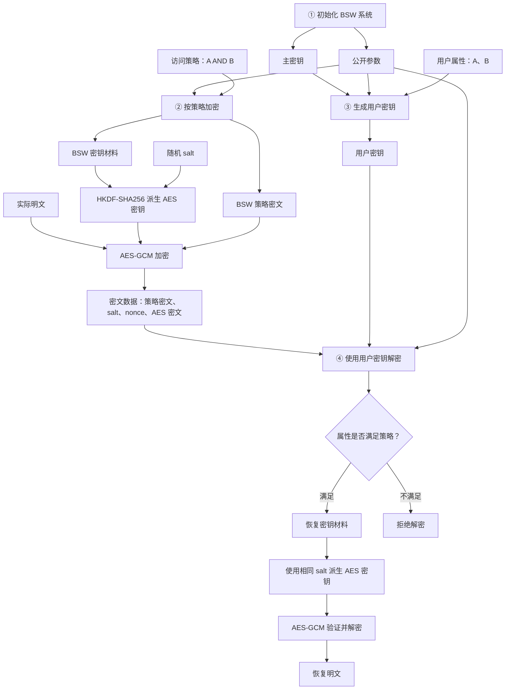
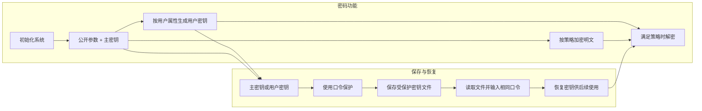

可以把整个密码功能想成一套**按属性发放钥匙、按策略加锁**的系统。先抓住最重要的区别：

- **主密钥**用于生成用户密钥，应该由系统管理者掌握。
- **用户密钥**带有用户属性，用于解密满足策略的数据。
- **口令**用于保护保存到文件中的密钥，不是用户的 ABE 属性。
- **封装数据**是为了保存和恢复，把密钥或密文整理成有固定格式的字节。

项目中的“演示密钥”指用于团队演示的密钥，其用途是演示和验证，并不是另一种独立的密码学密钥。

下面按照数据产生和使用的顺序讲。

### 一、先看整个流程



图中策略密文送到 AES-GCM，是因为代码把它作为**附加认证数据**：AES-GCM 会把它纳入完整性验证，但不把它当作明文加密。

### 二、初始化：公开参数和主密钥

创建一个新的 `BswCryptoService` 时，会初始化一个 BSW 系统，产生两类关键数据。

#### 1. 公开参数

公开参数可以理解为**这套系统的公共规则和公共材料**。生成用户密钥、加密和解密都需要它。

它不等于主密钥，也不需要像主密钥一样保密。但使用时仍要确认来源可信：如果有人把公开参数替换成另一套系统的数据，可能导致误用。

项目提供了公开参数指纹和核对方法，供调用方与**通过可信渠道取得的指纹**比较。指纹核对本身不会自动建立来源信任。

#### 2. 主密钥

主密钥是系统管理者持有的**签发用户密钥的核心秘密**。

例如管理员可以使用它生成：

```text
用户甲的密钥：属性为 doctor、hospital_a
用户乙的密钥：属性为 nurse、hospital_a
```

**谁持有主密钥，谁就能为这套系统生成不同属性的用户密钥。** 所以主密钥需要严格保护。

代码中，如果服务实例恢复时没有主密钥，它仍可在支持的场景下使用公开参数，但调用 `generateKey(...)` 会失败，因为没有签发用户密钥所需的主密钥。

### 三、生成用户密钥：属性和用户密钥

#### 3. 用户属性

属性是描述用户身份、角色或条件的字符串，例如：

```text
doctor
hospital_a
researcher
```

项目使用属性列表生成用户密钥，例如：

```java
List.of("doctor", "hospital_a")
```

这些字符串需要符合 `AttributeRules` 的命名规则。它们是**授权条件的一部分**，不是登录密码，也不是保护密钥文件的口令。

#### 4. 用户密钥

用户密钥由公开参数、主密钥和用户属性生成。它是用户实际用于解密的密钥。

例如：

```text
用户密钥的属性：doctor、hospital_a
密文访问策略：doctor AND hospital_a
```

这组属性满足策略，因此可以进入后续解密流程。

如果用户只有 `doctor` 属性，则不满足 `doctor AND hospital_a`，BSW 阶段会拒绝恢复密钥材料。

用户密钥本身也属于敏感数据，需要保护。项目中的对象类型是 `BswCryptoService.UserKey`。

### 四、加密：策略、密钥材料和 AES 密钥

#### 5. 访问策略

访问策略规定**什么属性组合可以解密**，例如：

```text
doctor AND hospital_a
```

或：

```text
doctor AND (hospital_a OR hospital_b)
```

它与用户属性的区别是：

- 属性描述用户拥有什么条件；
- 策略描述密文要求满足什么条件。

`policy` 包负责解析策略，然后 `BswCryptoService` 使用转换后的策略进行 BSW 加密。

#### 6. 明文

明文就是要保护的实际数据，例如一段文本或文件内容对应的字节。

当前 `BswCryptoService.encrypt(...)` 接收的是 `byte[]`，明文最大为 **1 MiB**。它不负责判断这些字节在业务上是病历、文档还是其他内容。

#### 7. BSW 密钥材料与策略密文

BSW 加密阶段会产生两项相互关联的内容：

- **密钥材料**：用于后续派生 AES 密钥。
- **策略密文**：包含 BSW 处理后的密文结构，使满足策略的用户密钥能够恢复对应的密钥材料。

可以把它理解为：BSW 按访问策略对后续加密需要的材料进行保护。属性不满足策略，就不能通过正常流程恢复这份材料。

#### 8. AES 密钥、`salt` 和 `nonce`

项目不直接使用 BSW 密钥材料加密明文，而是：

```text
BSW 密钥材料 + 随机 salt
          ↓ HKDF-SHA256
     32 字节 AES 密钥
          ↓
     AES-GCM 加密明文
```

这几个概念的用途不同：

| 名称 | 作用 | 是否需要保密 |
|---|---|---|
| BSW 密钥材料 | 派生 AES 密钥的输入；需通过满足策略的用户密钥恢复 | 需要保护 |
| AES 密钥 | 实际用于 AES-GCM 加解密 | 需要保护 |
| `salt` | 参与 HKDF 密钥派生，解密时需要相同的值 | 不需要保密，需要随密文保存 |
| `nonce` | AES-GCM 加密时使用的随机值，解密时需要相同的值 | 不需要保密，需要随密文保存 |

代码在每次加密时生成随机 `salt` 和 `nonce`，并在派生 AES 密钥后使用 AES-GCM 加密明文。AES-GCM 的输出还包含用于完整性验证的标签。

### 五、什么是“密文数据”和“封装的数据”？

这两个说法有关联，但侧重点不同。

#### 9. 密文数据

在当前代码里，一次加密的结果 `EncryptedData` 包含：

```text
BSW 策略密文
salt
nonce
AES-GCM 密文及认证标签
```

解密需要这些内容共同配合。它不是只有一段 AES 密文。

#### 10. 封装的数据

“封装”是指为了**保存、传输和恢复**，把数据按项目定义的格式整理成字节。例如导出密文时，大致是：

```text
[格式标记][版本][数据类型][系统标识][长度][密文内容]
```

导出公开参数、主密钥和用户密钥也使用相应类型的封装。恢复时，程序检查类型、长度等信息，并借助系统标识发现不同系统的数据误配。

这里的关键区别是：

> **封装是整理数据格式，不自动等于加密。**

例如 `exportMasterKey()` 返回的虽然是封装后的字节，但其中的主密钥仍是未受口令保护的敏感数据，不能因为“已经封装”就当作安全文件保存。

### 六、口令和受保护密钥：只在需要保存时介入

#### 11. 口令

口令是调用方提供的一串密码，用于保护要导出保存的**主密钥或用户密钥**。

```text
主密钥或用户密钥
        +
      用户口令
        ↓
口令保护处理
        ↓
受保护的密钥字节
        ↓
可写入受控文件
```

以后恢复时，需要读取受保护的字节并提供相同口令。口令错误或数据认证失败时，恢复会失败。

这个口令：

- **不是** `doctor`、`hospital_a` 这样的 ABE 属性；
- **不是**访问策略；
- **不是**明文本身的 AES 密钥；
- 不会在普通 `encrypt`、`decrypt` 调用时作为参数传入。

它参与的是**密钥保存与恢复**环节。代码使用 PBKDF2-HMAC-SHA256 从口令派生密钥，再使用 AES-GCM 保护导出的主密钥或用户密钥。

#### 12. 演示密钥

项目文档中的“演示密钥”是按**用途**命名的：

- 演示用主密钥：用于演示系统签发用户密钥；
- 演示用用户密钥：用于演示某些属性满足或不满足策略。

它们在代码里仍然分别是主密钥和用户密钥，并不是额外增加了一种叫“演示密钥”的密码算法或密钥类型。

项目当前的团队演示方案假设团队成员是共同维护演示系统的可信管理员。持有演示主密钥的成员可以签发任意属性的用户密钥，因此不能把这些管理员当作彼此隔离的普通用户。

### 七、把两个流程放在一起看



**密码功能流程**解决“谁能解密数据”；**保存与恢复流程**解决“程序结束后，怎样保护并重新取得密钥”。后者是可选环节：如果只在同一个进程中临时演示，密钥不需要落盘，就可以不使用口令保护文件。

这些解释对应当前项目原型，不代表它已经具备正式生产环境所需的完整密钥管理或通过安全审计。代码入口是 [BswCryptoService.java](D:/abe-intelligent-platform/module-b-codegen/src/main/java/com/abe/codegen/crypto/BswCryptoService.java)，持久化与口令保护的具体边界见 [B 模块持久化设计](D:/abe-intelligent-platform/docs/B模块持久化设计.md)。
