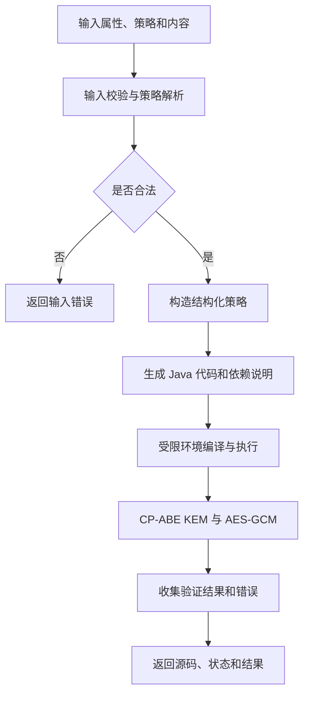
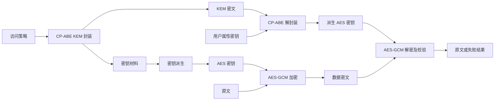

# B 模块开发计划

## 目标与当前基础

B 模块负责解析属性与访问策略，生成 Java 密钥生成、加密、解密示例，在受限环境执行，并返回验证结果与错误分析。

已选择基于 BSW 的 CP-ABE 实现，并在 Java 17 下验证重复属性策略、跨进程恢复及混合加密固定场景。固定版本已接入模块构建，现有内存密码适配；持久化与受限执行尚未实现。细节与限制见 [第一期选型记录](../module-b-codegen/第一期选型记录.md)。验证结果不等于安全审计。

## 总体流程



## 分步开发

### 1. 模块结构与接口契约

- 按实际需要整理 B 模块目录，不受现有占位目录约束。
- 定义输入模型：策略字符串、用户属性、待加密内容；输出模型包含生成源码、依赖说明、执行状态和错误信息。
- 明确策略处理、密码适配、代码生成、执行器和结果分析的内部职责。
- 明确属性命名、重复属性、策略长度和复杂度限制。

交付：模块基础结构、内部数据模型和首版输入规则。对外 HTTP 接口待 D 模块集成方式明确后确定。

### 2. 属性与策略解析

- 校验属性列表，处理空输入、不合法字符和重复属性。
- 解析 `AND`、`OR` 和括号，构造抽象语法树；优先级为括号、`AND`、`OR`。
- 为括号不匹配、缺少操作数等错误提供位置和原因。
- 将策略树转换为 BSW 接受的后缀策略，并验证合法输入与边界情况。

交付：属性校验、策略解析、策略转换和验证结果。阈值语法、属性否定及数值比较暂不纳入首版。

### 3. CP-ABE 密码适配

- 整理系统参数与主密钥生成、用户密钥生成、策略密钥封装与解封装。
- 确定密钥派生方式，使用 JDK AES-GCM 处理普通字节数据。
- 设计公开参数、密钥、封装密文、nonce、数据密文的序列化格式及密钥保护方式。
- 分类处理策略不满足、格式错误、完整性校验失败等异常；结合实际行为核实异常边界。
- 明确密码参数、属性数量和策略规模限制，验证授权、拒绝和篡改场景。

交付：内部密码适配能力、数据读写与恢复流程、验证记录。PoC 的临时明文密钥文件不是正式密钥存储方案。

### 4. Java 代码生成

- 根据已校验的数据生成初始化、密钥生成、加密、解密和结果检查示例。
- 附带可复现的 Maven 依赖与运行说明。
- 安全处理写入源码的字符串，避免引号、换行等输入破坏生成结果。
- 验证生成代码能够编译运行，且结果与输入一致。

交付：模板、生成器、源码及依赖说明。首版采用固定模板填充，不使用自由生成的密码学核心代码。

### 5. 受限执行与错误分析

- 为每次执行准备独立环境，编译并运行生成代码，收集状态和必要输出。
- 限制时间、CPU、内存、输出、文件访问与网络，并清理临时资源。
- 区分输入错误、生成失败、编译失败、超时、策略不满足和完整性失败等结果。
- Docker 作为候选方案，实际选型依赖环境验证；处理第一期观察到的线程生命周期问题。

交付：受限执行器、结构化结果、错误分类及资源清理机制。

### 6. 系统对接与完整验证

- 与 D 模块确定并实现调用接口。
- 对接 C 模块的输入、源码、执行状态和结果展示。
- 联合验证典型场景与异常场景，补充部署、使用说明和已知限制。

交付：可调用的模块、界面对接、端到端运行说明及验证记录。

## 核心算法设计

### 策略解析

首版可采用递归下降解析，语法为：

```text
表达式   := 与表达式 (OR 与表达式)*
与表达式 := 基本项 (AND 基本项)*
基本项   := 属性 | '(' 表达式 ')'
```

先把输入拆分为属性、运算符和括号，再按照语法构造策略树，最后遍历策略树生成 BSW 后缀门限表达式。`A AND B` 对应两个子项至少满足两个，`A OR B` 对应两个子项至少满足一个。策略树可辅助解释属性匹配，实际密码验证以解封装和解密结果为准。

### CP-ABE KEM 与 AES-GCM



加密时按策略封装随机密钥材料，经密钥派生后以 AES-GCM 加密原文，保存 KEM 密文、nonce 和数据密文。解密时用用户密钥解封装，再派生 AES 密钥，校验并恢复数据。完整方案的参数选择、密钥保护和安全限制仍需在实现时明确。

### 代码生成与执行分析

输入先经过校验，转成策略树和属性模型，再用固定模板填充生成源码。固定部分承载密码调用流程，变化部分包含属性、策略结构和配置；字符串必须安全编码。

执行结果按输入校验、代码生成、编译、运行和解密检查分阶段记录。底层异常应依据实际行为转换，不将所有 `IllegalArgumentException` 一概认定为策略不满足。

## 近期顺序

已完成内部数据模型及策略规则，并实现解析和 BSW 策略转换；下一步固定 BSW 依赖并整理密码适配层，再推进生成与执行。
